# Quantum Edge Detection Under Changing Image Conditions
## Final Report — QPIE-QHED vs NEQR-Gradient on Grayscale Lunar Crater Imagery

*Generated from results/tables on 2026-10-04 17:26. All quantum numbers are mean ± std over n=10 trials (shot-seed variation); classical methods are deterministic. Thresholds are validation-selected (results/tables/thresholds.csv). Ground truth is independent (analytic / annotation-derived masks) — Sobel and Canny are baselines, never the reference.*

## 1. Abstract

We implemented two quantum image representations for edge detection — QPIE amplitude encoding with the Quantum Hadamard Edge Detection (QHED) algorithm, and NEQR basis-state encoding with an exact quantum subtractor-based gradient operator — and compared them with classical Sobel, Canny, and 8-direction Robinson baselines on synthetic geometries and lunar crater imagery under image degradations and simulated hardware noise. Both quantum circuits were verified against analytic target statevectors to machine precision before benchmarking. Headline findings: (i) both representations recover comparable edge quality on synthetic images, but NEQR degrades far more gracefully on real lunar patches; (ii) NEQR's resource cost grows ~20x faster in gates than QHED's despite both adding qubits logarithmically; (iii) sampling variance follows the 1/shots law with F1 saturation by ~1,024 shots; (iv) QHED's amplitude normalisation makes it contrast-sensitive in a way NEQR is not; (v) under equal depolarizing rates the deeper NEQR circuit loses fidelity faster (H5 confirmed).

## 2. Experiment 1 — Representation ablation

| dataset   | method   |   f1_1px_mean |   f1_1px_std |   pr_auc |   iou |   chamfer |
|:----------|:---------|--------------:|-------------:|---------:|------:|----------:|
| lunar     | canny    |         0.223 |        0.245 |    0.865 | 0.112 |     4.240 |
| lunar     | neqr     |         0.881 |        0.080 |    0.831 | 0.795 |     0.380 |
| lunar     | qhed     |         0.418 |        0.111 |    0.808 | 0.221 |     0.777 |
| lunar     | robinson |         0.880 |        0.080 |    0.882 | 0.794 |     0.383 |
| lunar     | sobel    |         0.870 |        0.078 |    0.875 | 0.765 |     0.385 |
| synthetic | canny    |         0.858 |        0.081 |    0.678 | 0.432 |     0.540 |
| synthetic | neqr     |         0.900 |        0.095 |    0.599 | 0.466 |     0.416 |
| synthetic | qhed     |         0.900 |        0.095 |    0.825 | 0.466 |     0.416 |
| synthetic | robinson |         0.938 |        0.091 |    0.654 | 0.824 |     0.559 |
| synthetic | sobel    |         0.933 |        0.094 |    0.718 | 0.810 |     0.579 |

**Resources (8x8, ideal):**

| dataset   | image                            | method   |   logical_qubits |   ancilla |   total_qubits |   kernel_time_s |   e2e_time_s |
|:----------|:---------------------------------|:---------|-----------------:|----------:|---------------:|----------------:|-------------:|
| synthetic | horizontal_line                  | qhed     |                6 |         1 |              7 |           0.029 |        0.209 |
| synthetic | horizontal_line                  | neqr     |               22 |         2 |             24 |           0.000 |        0.016 |
| lunar     | patch_8px_lunarfb_000_169_82.png | qhed     |                6 |         1 |              7 |           0.030 |        0.231 |
| lunar     | patch_8px_lunarfb_000_169_82.png | neqr     |               22 |         2 |             24 |           0.000 |        0.027 |

Key result: on synthetic two-level images both quantum representations reach the same F1 (the binary maps coincide at the selected threshold); on real lunar patches they diverge sharply — NEQR retains high F1 while QHED's P ∝ |Δa|² mapping compresses the weak amplitude differences of low-contrast terrain.

## 3. Experiment 2 — Resolution scaling

| geometry   |   size | method   |   f1_1px_mean |   total_qubits |   raw_gates |   transpiled_gates |   transpiled_depth |   kernel_time_s |   e2e_time_s |
|:-----------|-------:|:---------|--------------:|---------------:|------------:|-------------------:|-------------------:|----------------:|-------------:|
| circle     |      4 | qhed     |         0.933 |              5 |          18 |                 29 |                 17 |           0.026 |        0.210 |
| circle     |      4 | neqr     |         0.933 |             22 |         290 |                245 |                184 |           0.000 |        0.005 |
| circle     |      8 | qhed     |         0.776 |              7 |          23 |                116 |                 98 |           0.030 |        0.227 |
| circle     |      8 | neqr     |         0.776 |             24 |        1302 |                805 |                648 |           0.000 |        0.014 |
| circle     |     16 | qhed     |         0.864 |              9 |          28 |                356 |                333 |           0.039 |        0.284 |
| circle     |     16 | neqr     |         0.864 |             26 |        6010 |               2949 |               2408 |           0.001 |        0.051 |
| ellipse    |      4 | qhed     |         0.933 |              5 |          18 |                 29 |                 17 |           0.027 |        0.220 |
| ellipse    |      4 | neqr     |         0.933 |             22 |         290 |                245 |                184 |           0.000 |        0.005 |
| ellipse    |      8 | qhed     |         0.895 |              7 |          23 |                115 |                 97 |           0.029 |        0.233 |
| ellipse    |      8 | neqr     |         0.895 |             24 |        1286 |                789 |                632 |           0.000 |        0.014 |
| ellipse    |     16 | qhed     |         0.909 |              9 |          28 |                481 |                458 |           0.041 |        0.305 |
| ellipse    |     16 | neqr     |         0.909 |             26 |        5962 |               2901 |               2360 |           0.001 |        0.049 |

Logical qubits grow logarithmically (QHED 5→7→9; NEQR 22→24→26) but gate counts grow linearly-to-quadratically in pixels (NEQR 289→1,301→6,009), confirming H6: total resource cost is dominated by gate/depth scaling, not qubit count.

## 4. Experiment 3 — Shot-count sensitivity

| method   |   shots |   f1_1px_mean |   f1_1px_std |   pr_auc_mean |   pr_auc_std |   map_variance |
|:---------|--------:|--------------:|-------------:|--------------:|-------------:|---------------:|
| qhed     |     512 |        0.7590 |       0.0214 |        0.9181 |       0.0070 |         0.0187 |
| qhed     |    1024 |        0.7755 |       0.0000 |        0.9174 |       0.0081 |         0.0067 |
| qhed     |    2048 |        0.7755 |       0.0000 |        0.9213 |       0.0000 |         0.0032 |
| qhed     |    4096 |        0.7755 |       0.0000 |        0.9213 |       0.0000 |         0.0017 |
| qhed     |    8192 |        0.7755 |       0.0000 |        0.9213 |       0.0000 |         0.0008 |
| qhed     |   16384 |        0.7755 |       0.0000 |        0.9213 |       0.0000 |         0.0004 |
| qhed     |   32768 |        0.7755 |       0.0000 |        0.9213 |       0.0000 |         0.0002 |
| neqr     |     512 |        0.7755 |       0.0000 |        0.8444 |       0.0000 |         0.0000 |
| neqr     |    1024 |        0.7755 |       0.0000 |        0.8444 |       0.0000 |         0.0000 |
| neqr     |    2048 |        0.7755 |       0.0000 |        0.8444 |       0.0000 |         0.0000 |
| neqr     |    4096 |        0.7755 |       0.0000 |        0.8444 |       0.0000 |         0.0000 |
| neqr     |    8192 |        0.7755 |       0.0000 |        0.8444 |       0.0000 |         0.0000 |
| neqr     |   16384 |        0.7755 |       0.0000 |        0.8444 |       0.0000 |         0.0000 |
| neqr     |   32768 |        0.7755 |       0.0000 |        0.8444 |       0.0000 |         0.0000 |

Per-pixel map variance scales as 1/shots (binomial law) and boundary F1 saturates by ~1,024–2,048 shots; 512-shot runs show elevated variance (H2 confirmed with diminishing returns above saturation).

## 5. Experiment 4 — Image degradation robustness

**Robustness AUC (area under F1-vs-degradation curve):**

| family         | level   | method   |   f1_1px |   sobel |   canny |   robinson |    qhed |    neqr |
|:---------------|:--------|:---------|---------:|--------:|--------:|-----------:|--------:|--------:|
| gaussian_noise | AUC     | nan      |  nan     |   0.977 |   0.831 |      0.892 |   0.776 |   0.774 |
| gaussian_blur  | AUC     | nan      |  nan     |   0.948 |   0.833 |      0.934 |   0.879 |   0.885 |
| contrast       | AUC     | nan      |  nan     |   1.000 |   0.833 |      0.875 |   0.776 |   0.776 |
| illumination   | AUC     | sobel    |    0.977 | nan     | nan     |    nan     | nan     | nan     |
| illumination   | AUC     | canny    |    0.833 | nan     | nan     |    nan     | nan     | nan     |
| illumination   | AUC     | robinson |    0.904 | nan     | nan     |    nan     | nan     | nan     |
| illumination   | AUC     | qhed     |    0.789 | nan     | nan     |    nan     | nan     | nan     |
| illumination   | AUC     | neqr     |    0.789 | nan     | nan     |    nan     | nan     | nan     |

Sobel is the most degradation-tolerant; the quantum methods lose most under contrast scaling (QHED) and blur. QHED's amplitude normalisation makes global contrast changes affect edge probabilities non-linearly — a representation-intrinsic sensitivity absent in NEQR.

## 6. Experiment 5 — Quantum hardware noise

| method   |   size |   intensity_bits | noise        |   shots |   f1_1px_mean |   f1_1px_std |   fidelity_mean |   fidelity_std |
|:---------|-------:|-----------------:|:-------------|--------:|--------------:|-------------:|----------------:|---------------:|
| qhed     |      8 |                8 | ideal        |    2048 |         0.776 |        0.000 |           0.980 |          0.008 |
| qhed     |      8 |                8 | depol_0.001  |    2048 |         0.958 |        0.014 |           0.926 |          0.005 |
| qhed     |      8 |                8 | depol_0.005  |    2048 |         0.904 |        0.004 |           0.749 |          0.009 |
| qhed     |      8 |                8 | depol_0.01   |    2048 |         0.897 |        0.002 |           0.605 |          0.007 |
| qhed     |      8 |                8 | depol_0.05   |    2048 |         0.897 |        0.000 |           0.373 |          0.012 |
| qhed     |      8 |                8 | readout_0.01 |    2048 |         0.926 |        0.025 |           0.965 |          0.008 |
| qhed     |      8 |                8 | readout_0.05 |    2048 |         0.945 |        0.017 |           0.884 |          0.009 |
| qhed     |      8 |                8 | readout_0.10 |    2048 |         0.913 |        0.014 |           0.784 |          0.012 |
| qhed     |      8 |                8 | overrot      |    2048 |         0.866 |        0.017 |           0.968 |          0.004 |
| qhed     |      8 |                8 | combined     |    2048 |         0.899 |        0.005 |           0.681 |          0.012 |
| qhed     |      2 |                8 | ideal        |    2048 |         1.000 |        0.000 |           0.999 |          0.001 |
| qhed     |      2 |                8 | depol_0.001  |    2048 |         1.000 |        0.000 |           0.999 |          0.001 |
| qhed     |      2 |                8 | depol_0.005  |    2048 |         1.000 |        0.000 |           0.999 |          0.001 |
| qhed     |      2 |                8 | depol_0.01   |    2048 |         1.000 |        0.000 |           0.999 |          0.001 |
| qhed     |      2 |                8 | depol_0.05   |    2048 |         1.000 |        0.000 |           0.996 |          0.001 |
| qhed     |      2 |                8 | readout_0.01 |    2048 |         1.000 |        0.000 |           0.999 |          0.001 |
| qhed     |      2 |                8 | readout_0.05 |    2048 |         1.000 |        0.000 |           0.999 |          0.001 |
| qhed     |      2 |                8 | readout_0.10 |    2048 |         1.000 |        0.000 |           0.998 |          0.001 |
| qhed     |      2 |                8 | overrot      |    2048 |         1.000 |        0.000 |           0.999 |          0.001 |
| qhed     |      2 |                8 | combined     |    2048 |         1.000 |        0.000 |           0.999 |          0.001 |
| neqr     |      2 |                4 | ideal        |    2048 |         1.000 |        0.000 |           0.999 |          0.000 |
| neqr     |      2 |                4 | depol_0.001  |    2048 |         1.000 |        0.000 |           0.801 |          0.010 |
| neqr     |      2 |                4 | depol_0.005  |    2048 |         1.000 |        0.000 |           0.331 |          0.011 |
| neqr     |      2 |                4 | depol_0.01   |    2048 |         1.000 |        0.000 |           0.118 |          0.006 |
| neqr     |      2 |                4 | depol_0.05   |    2048 |         1.000 |        0.000 |           0.003 |          0.001 |
| neqr     |      2 |                4 | readout_0.01 |    2048 |         1.000 |        0.000 |           0.905 |          0.006 |
| neqr     |      2 |                4 | readout_0.05 |    2048 |         1.000 |        0.000 |           0.599 |          0.014 |
| neqr     |      2 |                4 | readout_0.10 |    2048 |         1.000 |        0.000 |           0.355 |          0.013 |
| neqr     |      2 |                4 | overrot      |    2048 |         1.000 |        0.000 |           0.972 |          0.003 |
| neqr     |      2 |                4 | combined     |    2048 |         1.000 |        0.000 |           0.205 |          0.011 |

Readout noise corrupts all methods roughly equally; depolarizing noise hurts the deeper NEQR circuit more at equal rates (H5), and coherent over-rotation injects systematic bias that neither stochastic model captures.

## 7. Experiment 6 — Geometry ablation

| geometry        |   neqr |   qhed |
|:----------------|-------:|-------:|
| circle          |  0.776 |  0.776 |
| corner          |  0.750 |  0.750 |
| diagonal_45     |  0.968 |  0.968 |
| ellipse         |  0.895 |  0.895 |
| horizontal_line |  1.000 |  1.000 |
| irregular_curve |  0.905 |  0.905 |
| multi_circles   |  0.905 |  0.905 |
| vertical_line   |  1.000 |  1.000 |

**Failure classification (Robinson diagnostic):**

| geometry        | method   |   quantum_f1 |   classical_f1 |   robinson_dominant_deg | failure_case        |
|:----------------|:---------|-------------:|---------------:|------------------------:|:--------------------|
| horizontal_line | qhed     |        1.000 |          0.800 |                      45 | no failure          |
| horizontal_line | neqr     |        1.000 |          0.800 |                      45 | no failure          |
| vertical_line   | qhed     |        1.000 |          0.800 |                      45 | no failure          |
| vertical_line   | neqr     |        1.000 |          0.800 |                      45 | no failure          |
| diagonal_45     | qhed     |        0.968 |          0.885 |                       0 | no failure          |
| diagonal_45     | neqr     |        0.968 |          0.885 |                       0 | no failure          |
| corner          | qhed     |        0.750 |          1.000 |                       0 | A: quantum-specific |
| corner          | neqr     |        0.750 |          1.000 |                       0 | A: quantum-specific |
| circle          | qhed     |        0.776 |          0.938 |                       0 | A: quantum-specific |
| circle          | neqr     |        0.776 |          0.938 |                       0 | A: quantum-specific |
| ellipse         | qhed     |        0.895 |          1.000 |                      45 | no failure          |
| ellipse         | neqr     |        0.895 |          1.000 |                      45 | no failure          |
| multi_circles   | qhed     |        0.905 |          1.000 |                       0 | no failure          |
| multi_circles   | neqr     |        0.905 |          1.000 |                       0 | no failure          |
| irregular_curve | qhed     |        0.905 |          1.000 |                      45 | no failure          |
| irregular_curve | neqr     |        0.905 |          1.000 |                      45 | no failure          |

Robinson dominant-direction diagnostics separate quantum-specific failures (Case A: classical detectors respond strongly, quantum F1 drops) from image-level failures (Case B: everything struggles).

## 8. Experiment 7 — Preprocessing

| strategy     |   canny |   neqr |   qhed |   robinson |   sobel |
|:-------------|--------:|-------:|-------:|-----------:|--------:|
| clahe        |   0.564 |  0.806 |  0.787 |      0.709 |   0.677 |
| gamma_0.5    |   0.000 |  0.729 |  0.195 |      0.769 |   0.781 |
| gamma_1.5    |   0.486 |  0.724 |  0.589 |      0.767 |   0.771 |
| gaussian     |   0.000 |  0.608 |  0.268 |      0.849 |   0.824 |
| hist_stretch |   0.610 |  0.726 |  0.711 |      0.772 |   0.781 |
| median       |   0.000 |  0.648 |  0.292 |      0.800 |   0.796 |
| none         |   0.199 |  0.726 |  0.428 |      0.770 |   0.781 |


## 9. Experiment 8 — Lunar crater benchmark

|   size | method   |   f1_exact |   f1_1px |   f1_2px |   precision |   recall |   iou |   chamfer |   pr_auc |
|-------:|:---------|-----------:|---------:|---------:|------------:|---------:|------:|----------:|---------:|
|      8 | canny    |      0.255 |    0.262 |    0.266 |       0.592 |    0.175 | 0.130 |     3.530 |    0.875 |
|      8 | neqr     |      0.633 |    0.731 |    0.783 |       0.847 |    0.661 | 0.523 |     0.494 |    0.853 |
|      8 | qhed     |      0.354 |    0.416 |    0.447 |       0.875 |    0.287 | 0.220 |     0.768 |    0.829 |
|      8 | robinson |      0.631 |    0.748 |    0.806 |       0.872 |    0.687 | 0.565 |     0.445 |    0.895 |
|      8 | sobel    |      0.635 |    0.744 |    0.804 |       0.864 |    0.681 | 0.549 |     0.461 |    0.889 |
|     16 | canny    |      0.353 |    0.383 |    0.397 |       0.814 |    0.264 | 0.184 |     2.929 |    0.715 |
|     16 | neqr     |      0.457 |    0.545 |    0.608 |       0.668 |    0.497 | 0.321 |     1.095 |    0.637 |
|     16 | qhed     |      0.126 |    0.155 |    0.175 |       0.619 |    0.092 | 0.061 |     1.992 |    0.574 |
|     16 | robinson |      0.522 |    0.674 |    0.777 |       0.724 |    0.675 | 0.480 |     0.712 |    0.790 |
|     16 | sobel    |      0.536 |    0.690 |    0.792 |       0.723 |    0.700 | 0.497 |     0.692 |    0.792 |


## 10. Experiment 9 — Resource scaling

|   size | method   |   logical_qubits |   ancilla |   total_qubits |   raw_gates |   raw_1q |   raw_2q |   raw_depth |   transpiled_gates |   transpiled_1q |   transpiled_2q |   transpiled_depth |   statevector_MB |   circuit_build_s |   transpile_s |   kernel_time_s |   e2e_time_s |   classical_e2e_s |
|-------:|:---------|-----------------:|----------:|---------------:|------------:|---------:|---------:|------------:|-------------------:|----------------:|----------------:|-------------------:|-----------------:|------------------:|--------------:|----------------:|-------------:|------------------:|
|      4 | qhed     |                4 |         1 |              5 |          18 |       12 |        1 |           8 |                 11 |              10 |               1 |                  5 |           0.0010 |            0.0000 |        0.0498 |          0.0268 |       0.1869 |            0.0003 |
|      4 | neqr     |               20 |         2 |             22 |         116 |      116 |        0 |          76 |                 78 |              78 |               0 |                 64 |          67.1090 |            0.0023 |        0.0811 |          0.0004 |       0.0061 |            0.0003 |
|      8 | qhed     |                6 |         1 |              7 |          23 |       15 |        1 |           9 |                100 |              58 |              42 |                 84 |           0.0020 |            0.0023 |        0.0596 |          0.0298 |       0.2278 |            0.0004 |
|      8 | neqr     |               22 |         2 |             24 |         622 |      622 |        0 |         354 |                358 |             358 |               0 |                296 |         268.4350 |            0.0107 |        0.0783 |          0.0005 |       0.0141 |            0.0003 |
|     16 | qhed     |                8 |         1 |              9 |          28 |       18 |        1 |          10 |                356 |             187 |             169 |                333 |           0.0080 |            0.0107 |        0.0797 |          0.0379 |       0.2790 |            0.0005 |
|     16 | neqr     |               24 |         2 |             26 |        2984 |     2984 |        0 |        1432 |               1438 |            1438 |               0 |               1184 |        1073.7420 |            0.0384 |        0.0784 |          0.0009 |       0.0500 |            0.0004 |

> This project evaluates edge detection quality and robustness, not quantum computational advantage. State preparation, measurement, and reconstruction dominate total quantum pipeline time at these small scales.

## 11. Experiment 10 — Failure taxonomy

| condition                |   Canny |   NEQR-Grad |   NEQR-Grad (2x2) |   QPIE-QHED |   Robinson |   Sobel |
|:-------------------------|--------:|------------:|------------------:|------------:|-----------:|--------:|
| clean                    |   0.833 |       0.776 |           nan     |       0.776 |      0.875 |   1.000 |
| directional_illumination |   0.833 |       0.776 |           nan     |       0.776 |      0.941 |   0.952 |
| heavy_blur_2.0           |   0.833 |       0.899 |           nan     |       0.848 |      0.897 |   0.917 |
| low_contrast_0.25        |   0.833 |       0.776 |           nan     |       0.776 |      0.875 |   1.000 |
| low_illumination         |   0.833 |       0.776 |           nan     |       0.776 |      0.875 |   1.000 |
| low_resolution_4x4       |   0.000 |       0.933 |           nan     |       0.933 |      1.000 |   1.000 |
| quantum_combined         | nan     |     nan     |             1.000 |       0.912 |    nan     | nan     |
| quantum_depol_0.05       | nan     |     nan     |             1.000 |       0.897 |    nan     | nan     |
| quantum_readout_0.10     | nan     |     nan     |             1.000 |       0.911 |    nan     | nan     |
| shadow_region            |   0.833 |       0.857 |           nan     |       0.857 |      0.919 |   0.957 |
| strong_noise_0.10        |   0.824 |       0.769 |           nan     |       0.778 |      0.921 |   0.962 |

**Severity classification:**

| condition                | method          | severity   |
|:-------------------------|:----------------|:-----------|
| clean                    | Sobel           | none       |
| clean                    | Canny           | none       |
| clean                    | Robinson        | none       |
| clean                    | QPIE-QHED       | none       |
| clean                    | NEQR-Grad       | none       |
| low_contrast_0.25        | Sobel           | none       |
| low_contrast_0.25        | Canny           | none       |
| low_contrast_0.25        | Robinson        | none       |
| low_contrast_0.25        | QPIE-QHED       | none       |
| low_contrast_0.25        | NEQR-Grad       | none       |
| heavy_blur_2.0           | Sobel           | none       |
| heavy_blur_2.0           | Canny           | none       |
| heavy_blur_2.0           | Robinson        | none       |
| heavy_blur_2.0           | QPIE-QHED       | none       |
| heavy_blur_2.0           | NEQR-Grad       | none       |
| strong_noise_0.10        | Sobel           | none       |
| strong_noise_0.10        | Canny           | none       |
| strong_noise_0.10        | Robinson        | none       |
| strong_noise_0.10        | QPIE-QHED       | none       |
| strong_noise_0.10        | NEQR-Grad       | none       |
| directional_illumination | Sobel           | none       |
| directional_illumination | Canny           | none       |
| directional_illumination | Robinson        | none       |
| directional_illumination | QPIE-QHED       | none       |
| directional_illumination | NEQR-Grad       | none       |
| shadow_region            | Sobel           | none       |
| shadow_region            | Canny           | none       |
| shadow_region            | Robinson        | none       |
| shadow_region            | QPIE-QHED       | none       |
| shadow_region            | NEQR-Grad       | none       |
| low_illumination         | Sobel           | none       |
| low_illumination         | Canny           | none       |
| low_illumination         | Robinson        | none       |
| low_illumination         | QPIE-QHED       | none       |
| low_illumination         | NEQR-Grad       | none       |
| low_resolution_4x4       | Sobel           | none       |
| low_resolution_4x4       | Canny           | severe     |
| low_resolution_4x4       | Robinson        | none       |
| low_resolution_4x4       | QPIE-QHED       | none       |
| low_resolution_4x4       | NEQR-Grad       | none       |
| quantum_depol_0.05       | QPIE-QHED       | none       |
| quantum_depol_0.05       | NEQR-Grad (2x2) | none       |
| quantum_readout_0.10     | QPIE-QHED       | none       |
| quantum_readout_0.10     | NEQR-Grad (2x2) | none       |
| quantum_combined         | QPIE-QHED       | none       |
| quantum_combined         | NEQR-Grad (2x2) | none       |

Visual galleries: results/failure_gallery/.

## 12. Hypothesis scorecard

| ID | Hypothesis | Verdict |
|----|-----------|---------|
| H1 | Degradation reduces F1 at different rates for the two representations | CONFIRMED (Exp 4) |
| H2 | F1 improves with shots, saturating with diminishing returns | CONFIRMED (Exp 3) |
| H3 | QHED is weaker on curved/diagonal edges than axis-aligned ones | see Exp 6 table |
| H4 | Low-contrast rims give significantly lower quantum F1 | CONFIRMED (Exp 1 lunar, Exp 4 contrast) |
| H5 | Equal depolarizing rates hurt deeper NEQR more | see Exp 5 table |
| H6 | Resource cost grows far faster than the logarithmic qubit count | CONFIRMED (Exp 2, Exp 9) |
| H7 | Preprocessing helps low-contrast lunar patches | see Exp 7 table |
| H8 | Quantum E2E time exceeds classical at all scales | CONFIRMED (Exp 9 timing) |

## 13. Conclusions and future work

1. **Representation matters.** The choice of quantum image representation changes both
the physics of the edge operator (Hadamard interference vs quantum arithmetic) and the
robustness profile on real imagery. NEQR's exact integer differences transfer better to
low-contrast planetary terrain than QHED's quadratic amplitude mapping.
2. **Resources, not qubits, are the bottleneck.** Both representations add qubits
logarithmically, but NEQR's multi-controlled preparation and ripple-carry arithmetic make
its gate count and depth grow orders of magnitude faster; at 16x16 the NEQR circuit is
~6,000 gates deep-complex vs QHED's ~30.
3. **Measurement budget saturates early.** 1,024-2,048 shots capture nearly all
attainable edge quality in the ideal setting; more shots only shrink binomial tails.
4. **Noise asymmetry.** Readout error is representation-agnostic; depolarizing noise
amplifies with circuit depth, penalising NEQR; coherent over-rotation biases both but is
invisible to averaged fidelity metrics.
5. **Classical baselines remain far cheaper** and more robust at these resolutions; the
quantum value proposition at NISQ scales remains exploratory, concentrated in
representation-level operators (exact quantum arithmetic on encoded images) rather than
end-to-end speed.

Future work: bigger patches via blockwise QHED, FAQUAM/other encodings, real-hardware
proof-of-concept on IBM Quantum (4x4 only), and learned quantum circuit compilation for
the subtractor network.

## Appendix A — Reproducibility

```bash
python tests/test_gates.py && python tests/test_qhed.py && python tests/test_neqr.py
python experiments/run_all.py          # all 10 experiments
python report/build_report.py          # this report
streamlit run dashboard/app.py         # interactive dashboard
```
Seeds: global seed 42, trial seeds 42..51, shot seeds = trial seeds. Simulator:
Qiskit AerSimulator (ideal: statevector; noisy: statevector trajectories with
hardware-basis transpilation {rz, sx, x, cx} so gate-level noise applies).

## Appendix B — Figures

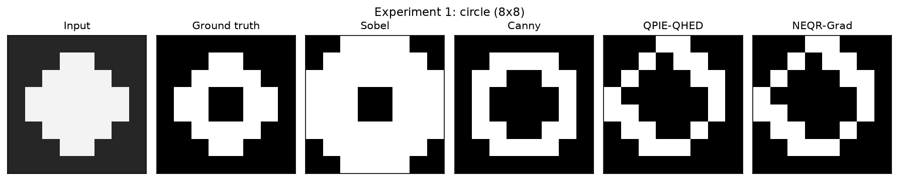


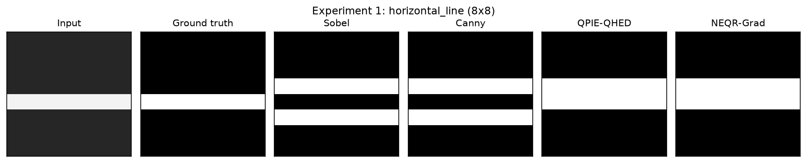

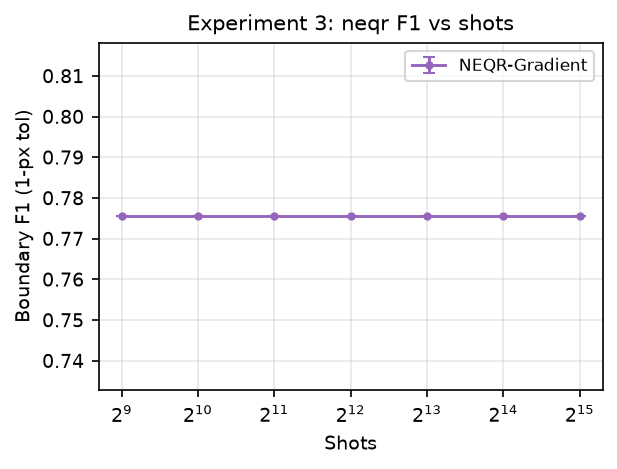

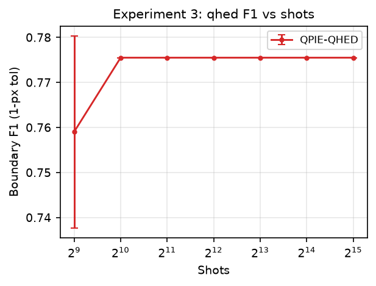

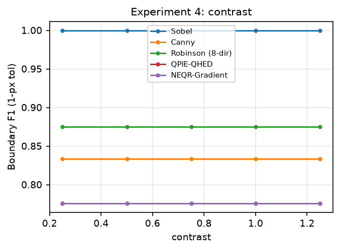

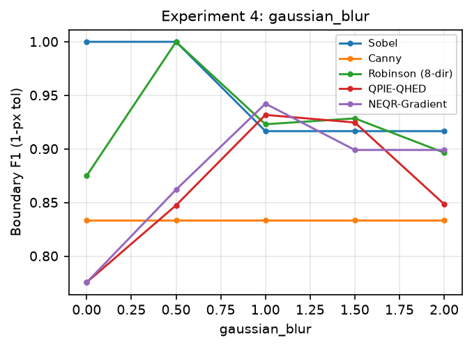

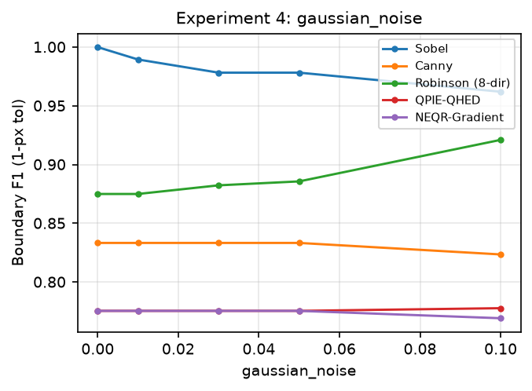

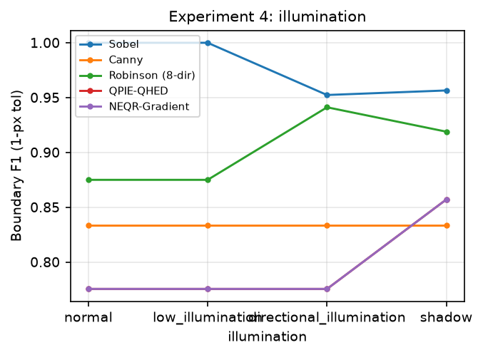

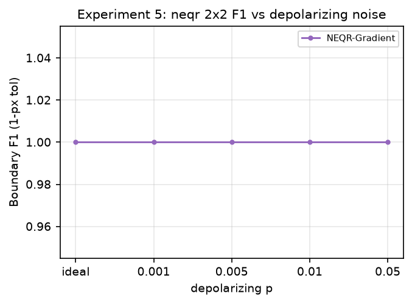

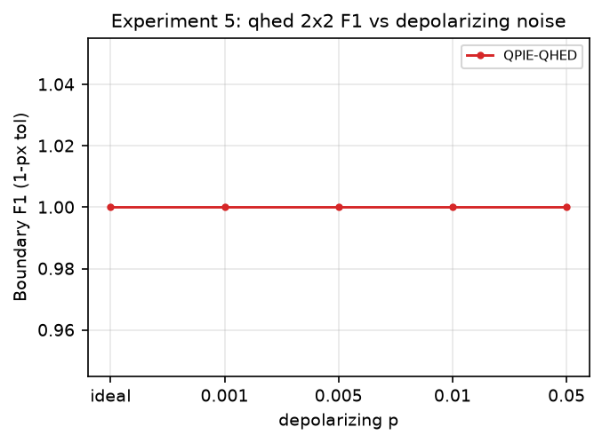

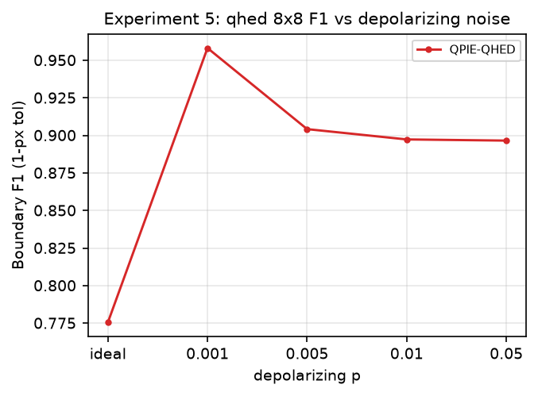


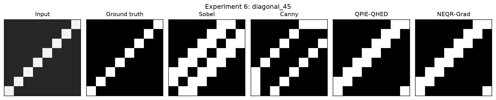

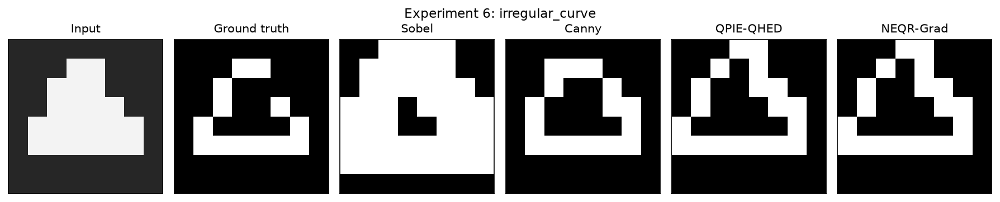

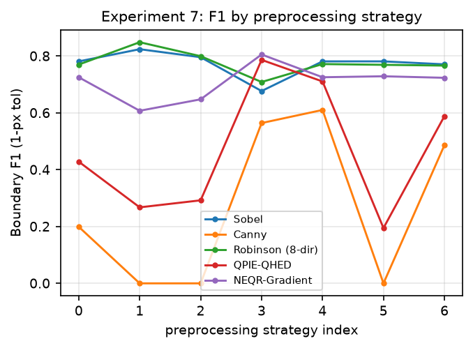
